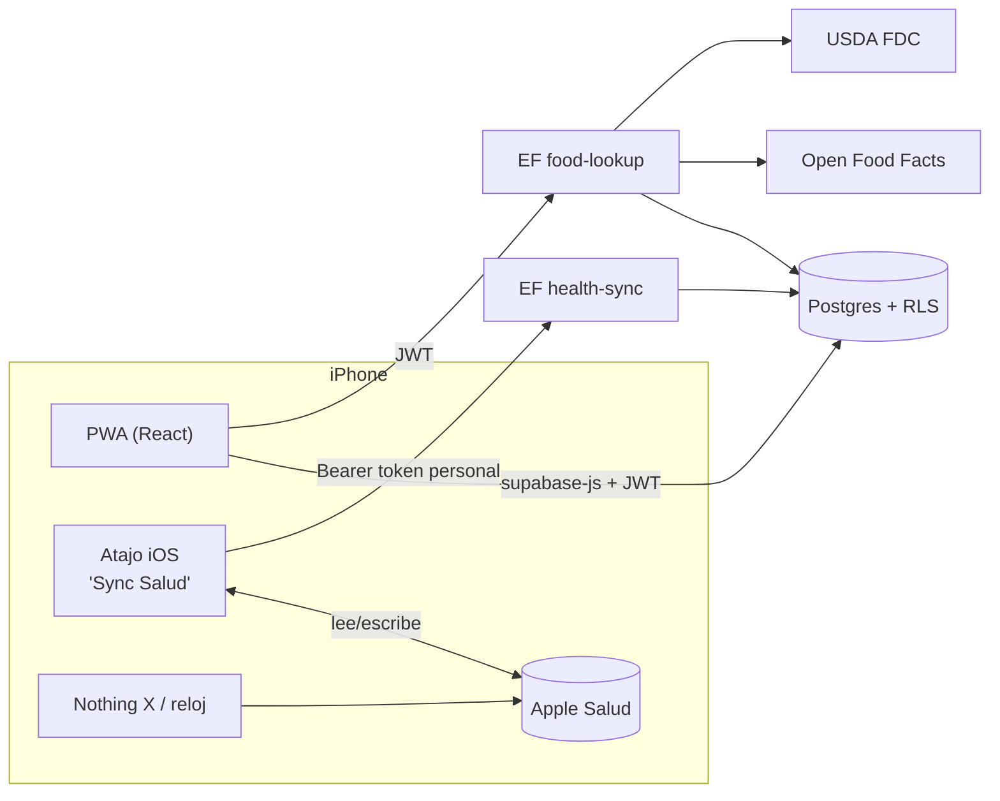

# 02 · TRD — Requisitos técnicos

> Estado: **v1.1 APROBADO (2026-11-16)** — decisiones abiertas cerradas con la propuesta · Fecha: 2026-11-16 · Depende de: 01-PRD v1.1

## 1. Plataforma
- **PWA** añadida a la pantalla de inicio de un **iPhone** con Safari. También funciona en escritorio.
- Necesita conexión siempre. El service worker solo cachea el *app shell*.
- **No hay app nativa.** El acceso a Apple Salud se hace con un **atajo de iOS** que habla con el backend (§6.4).

## 2. Stack
| Capa | Tecnología |
|---|---|
| Lenguaje | TypeScript (strict) |
| Frontend | React 18 + Vite + `vite-plugin-pwa` |
| Routing | React Router |
| Estado del servidor | TanStack Query |
| Formularios y validación | React Hook Form + **Zod**, con esquemas compartidos entre el frontend y las Edge Functions (`packages/schemas`) |
| Estilos | Tailwind CSS |
| Gráficas | Recharts |
| Escáner | `@zxing/browser`, porque iOS Safari no tiene `BarcodeDetector`; si el navegador lo tiene, se usa el nativo |
| Backend | Supabase: Postgres, Auth, Edge Functions (Deno) y RLS |
| Hosting | Cloudflare Pages |
| Tests | Vitest, Testing Library y Playwright (perfil WebKit para simular Safari) |
| CI | GitHub Actions |

## 3. Arquitectura



- **`domain/`:** funciones puras (§7) con el 100 % de tests unitarios.
- **`packages/schemas`:** esquemas Zod del formato de intercambio (§8), de los datos de Salud y de las tablas.
- **Edge Functions:**
  - `food-lookup` (§6.1–6.2): búsqueda y escaneo, con caché y normalización.
  - `health-sync` (§6.4): recibe muestras de Salud y entrega las comidas pendientes de exportar.
- **El cálculo del TDEE semanal se hace en el cliente** al abrir la app y genera una propuesta que confirmas.

## 4. Almacenamiento y fuente de verdad
- **Supabase es la fuente de verdad única** de todos los datos de la app, incluidos los pesos importados.
- Apple Salud es una **fuente de entrada** (peso y pasos) y un **destino de salida** (nutrición). La app nunca lee de Salud la nutrición que ella misma escribió.
- **Caché de productos externos:** cada consulta a OFF o USDA se guarda como producto con `source` y `source_id`. Si el producto tiene `manually_edited = true`, una nueva consulta no lo sobrescribe (§6.3).
- **Copia de seguridad:** exportación propia en JSON y CSV (§8).

## 5. Autenticación y seguridad
- Email y contraseña con Supabase Auth. Tras crear tu cuenta se desactiva el registro.
- RLS en todas las tablas (`user_id = auth.uid()`). El seed de alimentos es de solo lectura para cualquier usuario autenticado.
- **Token personal para el atajo:** se genera en Ajustes (32 bytes aleatorios) y se muestra una sola vez. En la base solo se guarda su `sha256`; se puede revocar y regenerar. Solo da permiso para usar `health-sync`.
- Secretos (clave de USDA y la *service role key*) solo en las Edge Functions.
- Sin analítica y sin enviar datos personales a OFF ni a USDA.

## 6. Integraciones

### 6.1 Open Food Facts
- `GET https://world.openfoodfacts.org/api/v2/product/{ean}.json?fields=code,product_name,product_name_es,brands,categories_tags,quantity,product_quantity,product_quantity_unit,nutriments,serving_quantity,stores`
- Cabecera: `User-Agent: AppCalorias/0.1 (uso personal)`.
- **El producto existe solo si `status === 1`.** Si no, se trata como no encontrado aunque la respuesta sea HTTP 200.
- Energía por 100, por orden de preferencia:
  1. `energy-kcal_100g`
  2. `energy_100g` ÷ 4.184
  3. Valores `_serving` × 100 / `serving_quantity`
  4. Si no hay ninguno, `null` y el producto se marca con `needs_review`.
- Resto de nutrientes: los valores `_100g`. Si falta uno, se guarda `null`, no 0.
- `base_unit`: `ml` si `product_quantity_unit` es `ml` o `l`; si no, `g`.
- `stores` → se proponen supermercados (S7), sin crearlos automáticamente.
- Coherencia: si `|kcal − (4P + 4C + 9G)| > 20 %`, el producto se marca con `needs_review`.
- Atribución ODbL visible.

### 6.2 USDA FoodData Central
- `GET /fdc/v1/foods/search?query={q}&dataType=Foundation,SR%20Legacy&pageSize=20` con la `api_key` en el servidor.
- Mapeo de nutrientes por `nutrientNumber`:
  | Nutriente | `nutrientNumber` |
  |---|---|
  | kcal | 208 |
  | Proteína | 203 |
  | Grasa | 204 |
  | Carbohidratos | 205 |
  | Fibra | 291 |
  | Azúcar | 269 |
  | Grasa saturada | 606 |
  | Sodio | 307 |
- Sal (g) = sodio (mg) × 2.5 / 1000. Siempre `base_unit = g`.
- Búsqueda en español en la base local y, si no hay resultados, en inglés en USDA. El producto se puede renombrar al guardarlo.

### 6.3 Reglas de refresco de la caché
- Al volver a consultar un producto que ya está en la caché:
  - Si `manually_edited = false`, se actualizan los campos que vienen de la API y `updated_at`.
  - Si `manually_edited = true`, **no se toca**. Solo se guarda `remote_snapshot` (el JSON crudo) para poder comparar a mano.
- Cualquier edición desde la interfaz pone `manually_edited = true` y cambia `source` a `manual` solo si el producto se creó desde cero. Si venía de una API, conserva su `source` original.

### 6.4 Apple Salud mediante Atajos (M12, S8)

**Endpoint** `POST /functions/v1/health-sync`, con la cabecera `Authorization: Bearer <token personal>`.

**Petición del atajo:**
```json
{
  "device": "iPhone",
  "samples": [
    { "type": "weight", "value": 78.4, "unit": "kg", "start": "2026-11-16T07:42:00+01:00", "source": "Nothing X" },
    { "type": "steps", "value": 9312, "start": "2026-11-16T00:00:00+01:00", "end": "2026-11-16T23:59:59+01:00", "source": "Nothing X" },
    { "type": "active_kcal", "value": 512, "start": "...", "end": "...", "source": "Nothing X" }
  ],
  "ack_exported": ["<diary_entry_id>", "..."]
}
```

**Respuesta:**
```json
{
  "imported": { "weight": 3, "steps": 7, "active_kcal": 7, "duplicates": 4 },
  "to_export": [
    { "id": "<diary_entry_id>", "at": "2026-11-16T14:05:00+01:00",
      "energy_kcal": 640, "protein_g": 42, "carbs_g": 70, "fat_g": 18,
      "fiber_g": 8, "sugars_g": 6, "saturated_fat_g": 5 }
  ]
}
```

**Flujo del atajo:**
1. Busca en Salud las muestras de peso, pasos y energía activa de los últimos **7 días**.
2. Las convierte a JSON y llama a `health-sync` con el campo `ack_exported` de la ejecución anterior.
3. Para cada elemento de `to_export`, registra una muestra de Salud por nutriente con la fecha de `at`. Si un nutriente es `null`, se omite.
4. Guarda los IDs exportados para enviarlos en `ack_exported` en la siguiente ejecución. Así, si una ejecución falla a mitad, no se pierde nada.

**Cuándo se ejecuta:**
- Automatización personal diaria a las 23:30 (configurable).
- Botón "Sincronizar con Salud" en la app, que abre `shortcuts://run-shortcut?name=Sync%20Salud`.
- La sincronización es solo en primer plano o mediante la automatización, sin procesos propios en segundo plano.

**Permisos:** los concede iOS al atajo la primera vez: lectura de peso, pasos y energía activa, y escritura de los tipos de nutrición. La app web no necesita ningún permiso.

**Deduplicación y reglas:**
- `external_id = sha256(type + start + end + value + source)`, con restricción única por usuario. Una muestra repetida se ignora.
- **Peso:** se guardan todas las muestras en `health_samples`, pero el **peso del día** se elige así:
  1. Si hay una entrada **manual** ese día, es esa.
  2. Si no, la **muestra más temprana del día**, porque el peso en ayunas es más estable.
  - Se descartan los valores fuera de 30–300 kg.
- **Pasos y energía activa:** un total por día. Si hay varias fuentes, se queda el **máximo** de ese día, para no sumar dos veces lo que reportan el reloj y el iPhone.
- **La energía activa solo es informativa** y no entra en ninguna fórmula.
- **Exportación:** solo se exportan los registros con `exported_at IS NULL`. Si editas un registro ya exportado, se marca `export_dirty = true` y aparece en Ajustes como "editado tras exportar". Los atajos no pueden borrar muestras de Salud, así que **no se reescribe** en Salud.

**Guía:** el documento `docs/atajo-salud.md` explicará paso a paso cómo montar el atajo y la automatización.

## 7. Fórmulas y algoritmos (especificación exacta)
Unidades: kg, cm y años (calculados desde la fecha de nacimiento) y kcal. Sin redondeo interno; en pantalla, kcal enteras y gramos con 1 decimal.

### 7.1 TMB
- **Mifflin-St Jeor:**
  - Hombre: `10·peso + 6.25·altura − 5·edad + 5`
  - Mujer: `10·peso + 6.25·altura − 5·edad − 161`
- **Katch-McArdle** (S4): `masa_magra = peso·(1 − grasa_pct/100)` y `TMB = 370 + 21.6·masa_magra`.
- Como `peso` se usa la tendencia actual si existe; si no, el último peso.

### 7.2 TDEE inicial y objetivo
- `TDEE_0 = TMB · factor`, con `factor ∈ {1.2, 1.375, 1.55, 1.725, 1.9}`.
- `objetivo_kcal = TDEE + ajuste`. El ajuste vale entre −500 y −300 para perder (por defecto −400), 0 para mantener y entre +150 y +300 para ganar (por defecto +250).
- **Suelo:** 1.500 kcal en hombre y 1.200 kcal en mujer.

### 7.3 Macros
- `proteina_g = prot_g_kg · peso`, con `prot_g_kg ∈ [1.4, 2.0]` (por defecto 1.8).
- `grasa_g = objetivo_kcal · grasa_pct / 9`, con `grasa_pct ∈ [0.25, 0.30]` (por defecto 0.27).
- `carbos_g = max(0, (objetivo_kcal − 4·proteina_g − 9·grasa_g) / 4)`.

### 7.4 Nutrientes de un registro
- `cantidad` va en la `base_unit` del producto (g o ml). Con porciones: `cantidad = n_porciones · porcion.amount`.
- `valor = cantidad · valor_100 / 100`. Si `valor_100` es null, el resultado es null.
- **Snapshot (M16):** el registro guarda una copia de los valores calculados y de los `valor_100` usados.
- **Aplicar corrección a registros anteriores:** al editar los nutrientes de un producto, la app ofrece recalcular los snapshots de los registros con ese `product_id` en un rango de fechas (por defecto, todos). Antes de aplicarlo muestra cuántos registros cambian y en cuántas kcal.
- Totales del día: la suma de los valores que no son null. Si algún registro tiene un nutriente null, el total se muestra como "parcial".

### 7.5 Recetas (S1)
- Para cada nutriente: `total_n = Σ(cantidad_i · n_100_i / 100)`.
- `peso_total` = el peso final cocinado si lo introduces; si no, `Σ cantidad_i`. Si mezcla g y ml sin densidad, se trata 1 ml como 1 g y la receta se marca con `needs_review`.
- La receta se guarda como un producto derivado (`source = receta`, `base_unit = g`) con `n_100 = total_n / peso_total · 100`.
- Si se indican raciones, se crea la porción "ración" de `peso_total / raciones`.

### 7.6 Tendencia de peso (EMA)
- Se calcula sobre el **peso del día** (§6.4), ordenado por fecha:
  - Primer día: `T_1 = w_1`
  - Días siguientes: `T_i = T_{i−1} + 0.1·(w_i − T_{i−1})`
- Los días sin peso no actualizan la tendencia.
- Si se importa un peso de un día pasado, la EMA se recalcula desde ese día.

### 7.7 TDEE adaptativo
Semanas de lunes a domingo, en Europe/Madrid.

1. **Arranque:** no hay ajuste hasta que han pasado al menos 14 días desde el primer registro, hay al menos 10 días registrados y al menos 7 pesajes. Hasta entonces, `tdee = TDEE_0`.
2. `dias_registrados` = días de la semana con al menos un registro y sin la marca "incompleto". Si `dias_registrados < 5` o no hay ningún pesaje en la semana, no hay propuesta esa semana.
3. `kcal_media` = la media de las kcal de los `dias_registrados`.
4. `Δtendencia = T(domingo s) − T(domingo s−1)`
5. `tdee_obs = kcal_media − (Δtendencia · 7700) / 7`
6. `tdee_propuesto = clamp(0.8·tdee + 0.2·tdee_obs, tdee − 150, tdee + 150)`
7. `objetivo_propuesto = tdee_propuesto + ajuste`, con el suelo de la §7.2. Los macros se recalculan.
8. La propuesta queda **pendiente**. Si la aceptas, `tdee := tdee_propuesto`; si la rechazas, el TDEE no cambia. Queda un historial completo.
9. **Los pasos y las kcal activas no intervienen.**

### 7.8 Ritmo de cambio
`ritmo_kg_semana = T(hoy) − T(hoy − 7 días)`. Solo se muestra con 7 días de tendencia o más.

## 8. Formato de intercambio (importación desde IA, copia de seguridad y exportación)

### 8.1 Esquema
Es el JSON `schema_version: 1` del usuario, **ampliado con claves opcionales**. El bloque `products` es idéntico al que genera la IA, así que el mismo validador sirve para las dos cosas:

```json
{
  "schema_version": 1,
  "exported_at": "ISO-8601 | omitido",
  "products": [ /* formato IA, más los campos opcionales de copia de seguridad: id, favorite, manually_edited, created_at, updated_at, supermarket_prices: [{name, price}] */ ],
  "supermarkets": [{ "name": "string" }],
  "recipes": [ ... ], "saved_meals": [ ... ],
  "meal_slots": [ ... ], "diary": [ ... ], "weights": [ ... ],
  "profile": { ... }, "tdee_history": [ ... ]
}
```

- Si el archivo solo trae `products`, es una **importación de productos**: el flujo M15.
- Si trae otras claves, es una **restauración de la copia de seguridad**: se muestra un resumen por tabla y una confirmación. Las reglas de conflicto son las mismas para los productos; para el resto, los `id` deciden si se actualiza o se inserta.
- La forma exacta de cada clave adicional se fija en el documento 05 (Backend Schema).
- **Validación:** Zod, en modo estricto en los tipos y tolerante con las claves desconocidas, que se ignoran con un aviso. Límite de 5 MB y 2.000 productos por archivo.

### 8.2 Importación de productos (M15)
1. Entrada: pegar texto o abrir un archivo `.json`. Se aceptan valores `number` y cadenas numéricas con coma decimal ("3,5").
2. Validación: los errores se muestran por producto y campo, y un producto con errores no se puede importar hasta corregirlo en la vista previa.
3. **Vista previa editable** con todos los campos de la M14. Cada producto lleva insignias:
   - **⚠ revisar** si `confidence = baja`, si `source = estimado` o si falla la comprobación de coherencia de kcal.
   - Sus `warnings`, desplegables.
4. **Detección de duplicados**, por orden:
   1. Mismo `barcode`.
   2. Mismo nombre y marca normalizados (minúsculas, sin tildes y sin espacios repetidos).
5. Para cada duplicado eliges una opción (con "aplicar a todos"):
   - **Actualizar:** reemplaza los campos con los del JSON.
   - **Fusionar:** solo rellena los campos `null` del existente y une las porciones y los supermercados.
   - **Crear nuevo.**
   - **Omitir.**
6. Supermercados: si un nombre no existe, la vista previa propone crearlo, nunca de forma silenciosa.
7. Todo se guarda en una transacción: o se importa todo lo seleccionado o nada.
8. `source` de la IA (`etiqueta`, `web` o `estimado`) se guarda tal cual, y `confidence` y `warnings` también se guardan.

### 8.3 Exportación
- **JSON completo:** todo en el formato de la §8.1. Si se importa sobre una base vacía, el resultado es idéntico (test de ida y vuelta).
- **CSV:** un archivo por tabla (products, diary, weights…), en UTF-8 con BOM y separador `;` para que Excel en español lo abra bien, empaquetados en un `.zip`.
- La descarga se genera en el cliente.

## 9. Requisitos no funcionales
| Área | Requisito |
|---|---|
| Rendimiento | LCP de menos de 2.5 s en 4G y bundle inicial de menos de 250 KB gzip. Registrar un favorito es inmediato (optimista). |
| Velocidad de uso | Un favorito o reciente se registra con 3 toques o menos. |
| Búsqueda | Local en menos de 300 ms con `pg_trgm` y `unaccent`. Externa en menos de 2 s. |
| Escáner | Lectura en menos de 2 s con buena luz, con introducción manual del código si falla. |
| Importación | Validar y mostrar la vista previa de 200 productos en menos de 1 s. |
| Sincronización con Salud | `health-sync` responde en menos de 1.5 s con 7 días de muestras. Es idempotente: ejecutarla dos veces no duplica nada. |
| Sin conexión | No se soporta. Sin red se muestra un aviso claro. |
| Privacidad | Datos solo en tu Supabase con RLS. Token del atajo guardado como hash y revocable. |
| Coste | 0 €. |
| Accesibilidad | WCAG 2.1 AA y objetivos táctiles de 44 px o más. |
| Entornos | Dos proyectos de Supabase en la nube con plan gratuito: `calorias-dev` y `calorias-prod`, sin Docker. Migraciones versionadas con la CLI (`supabase db push`). Enmienda del 2026-11-16, según el Implementation Plan. |
| Calidad | `domain/` y `schemas/` con el 100 % de tests. Test de ida y vuelta de la exportación y la importación. CI en verde. |

## Decisiones abiertas
1. **Seed de alimentos habituales:** propuesta de unos 150 alimentos básicos de USDA (CC0), traducidos a mano.
2. **Zona horaria:** propuesta de fijar Europe/Madrid.
3. **Peso del día con varias muestras de Salud:** propuesta de usar la más temprana, en vez de la última o la media.
4. **Pasos con varias fuentes:** propuesta de quedarse con el máximo diario.

## Supuestos
- Atajos puede leer las muestras de Salud con su fecha y su fuente, y registrar muestras de los tipos de nutrición de la dieta.
- Las automatizaciones personales de Atajos se ejecutan sin confirmación a la hora programada (iOS 17 o posterior).
- La constante de 7.700 kcal por kg es suficiente.
- El plan gratuito de Supabase mantiene sus condiciones (500 MB de base de datos y 500.000 invocaciones de Edge Functions al mes).
- OFF y USDA mantienen sus endpoints y sus licencias.
