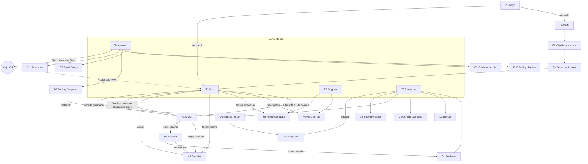
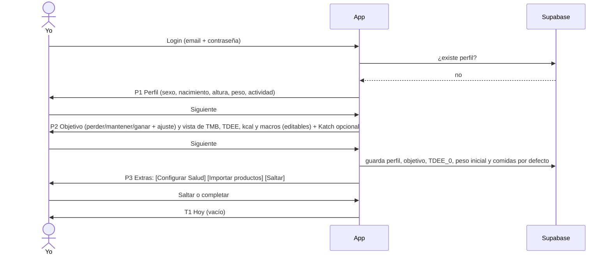
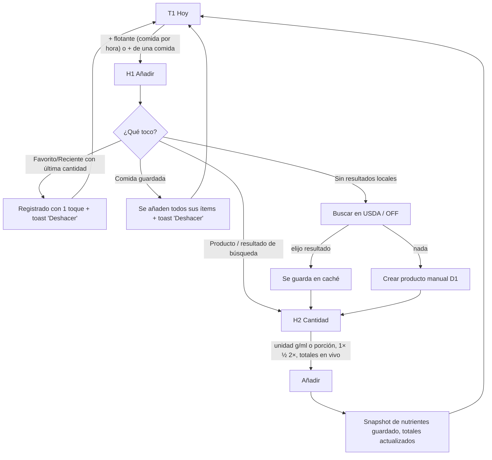
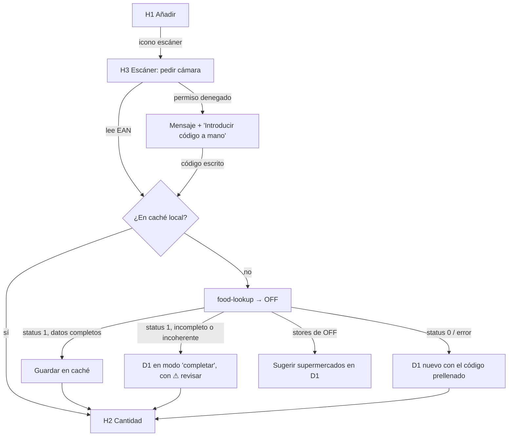
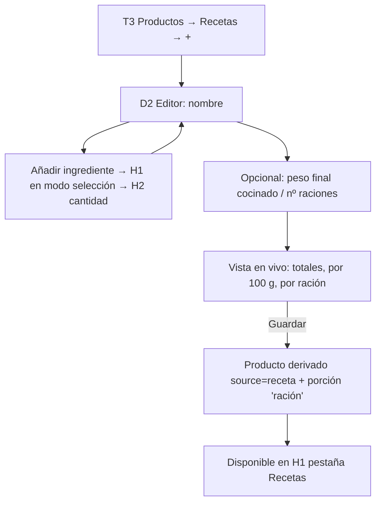
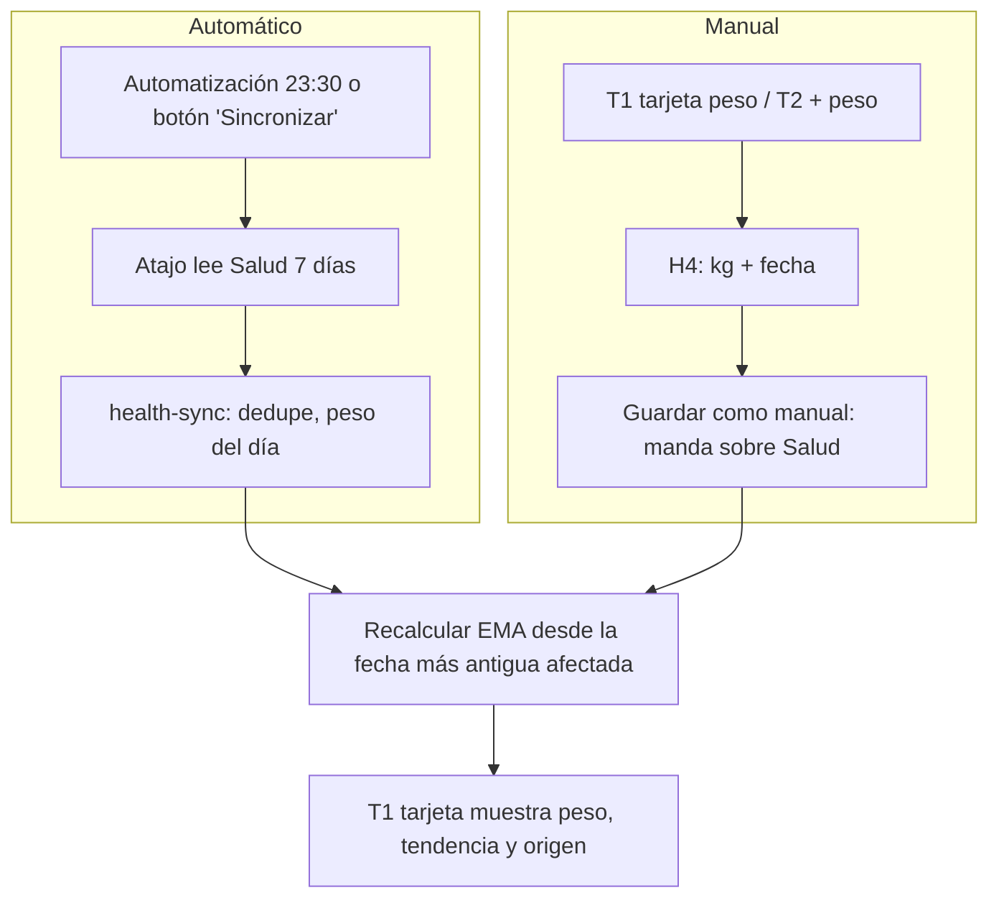
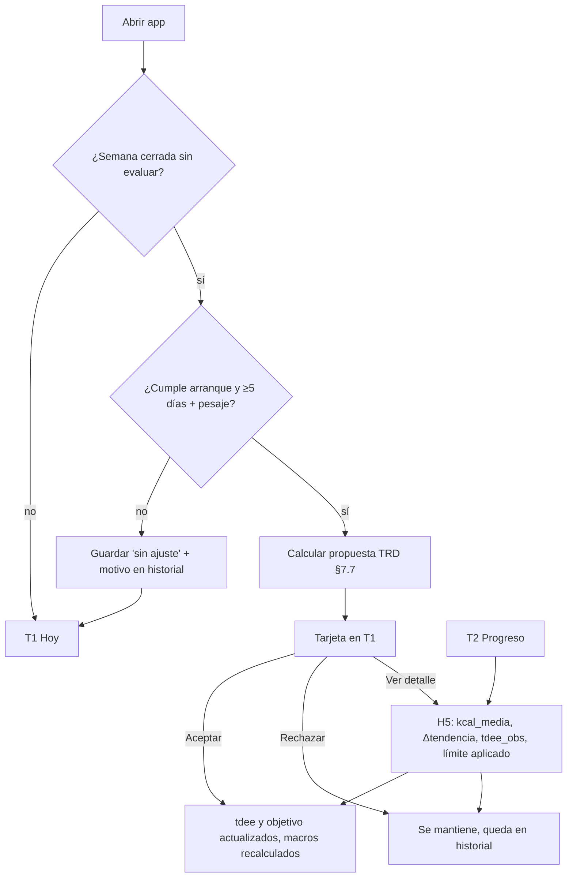
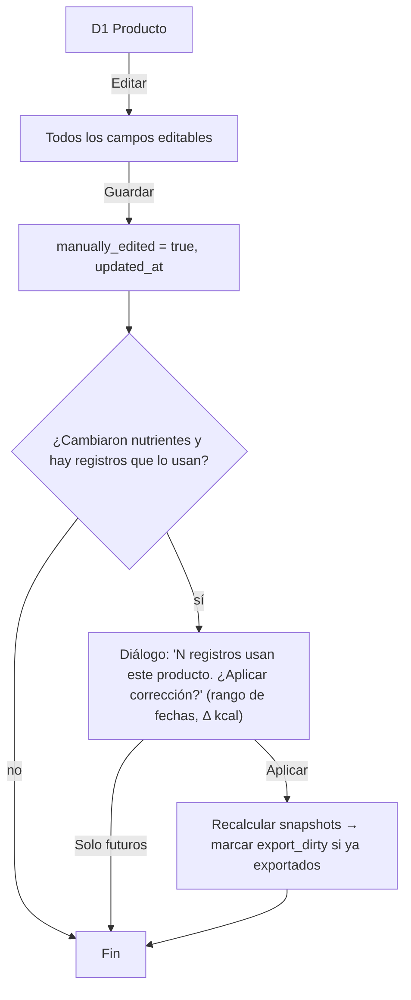
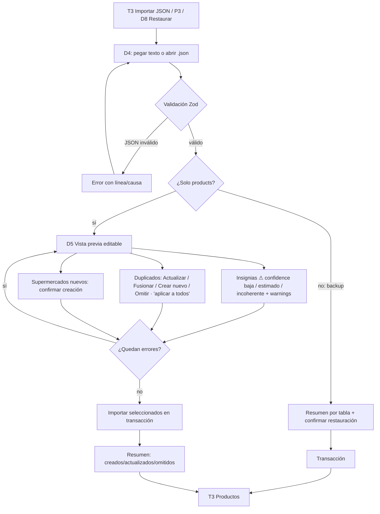
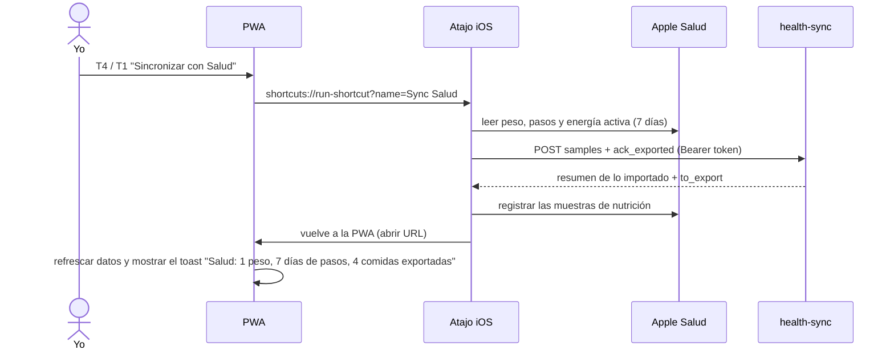

# 03 · App Flow

> Estado: **APROBADO (2026-11-16)** — decisiones abiertas cerradas con la propuesta · Fecha: 2026-11-16 · Depende de: PRD v1.1 y TRD v1.1 (aprobados)

## 1. Inventario de pantallas

| ID | Pantalla | Tipo | Requisitos |
|---|---|---|---|
| P0 | Login | Pantalla | M11 |
| P1 | Onboarding 1 · Perfil | Pantalla | M1 |
| P2 | Onboarding 2 · Objetivo y macros | Pantalla | M1, S4 |
| P3 | Onboarding 3 · Extras opcionales (Salud e importar productos) | Pantalla | M12, M15 |
| **T1** | **Hoy** (diario) | Pestaña | M6, M7, M8, M10 |
| **T2** | **Progreso** | Pestaña | M9, M10, S3 |
| **T3** | **Productos** | Pestaña | M2, M13, M14, S1, S2, S7 |
| **T4** | **Ajustes** | Pestaña | M1, M12, S9 |
| H1 | Añadir (hoja de búsqueda unificada) | Hoja | M3, M13, S2, S5, S7 |
| H2 | Cantidad | Hoja | M5, M6, M16 |
| H3 | Escáner | Pantalla completa | M4 |
| H4 | Peso del día | Hoja | M8 |
| H5 | Propuesta de TDEE (detalle) | Hoja | M10 |
| D1 | Ficha y edición de producto | Pantalla | M14, M16, S7 |
| D2 | Editor de receta | Pantalla | S1 |
| D3 | Editor de comida guardada | Pantalla | S2 |
| D4 | Importar JSON: entrada | Pantalla | M15, S9 |
| D5 | Importar JSON: vista previa y conflictos | Pantalla | M15 |
| D6 | Supermercados | Pantalla | S7 |
| D7 | Salud: token y guía del atajo | Pantalla | M12, S8 |
| D8 | Copia de seguridad y exportar | Pantalla | S9 |
| D9 | Comidas del día (configurar las franjas) | Pantalla | M6 |
| D10 | Perfil y objetivo (editar) | Pantalla | M1 |
| D11 | Acerca de y atribuciones (ODbL) | Pantalla | TRD §6.1 |

## 2. Mapa de navegación

## 3. Contenido de las pantallas principales

**T1 Hoy**
- Cabecera: selector de fecha (‹ hoy ›) y menú ⋯ con "Marcar día incompleto" y "Copiar día…".
- Resumen: kcal consumidas y restantes, y barras de proteína, carbohidratos y grasa. Fibra, azúcar, sal y grasa saturada se pliegan en "más".
- Tarjeta de propuesta de TDEE, solo si hay una pendiente.
- Tarjeta de peso del día (origen: Salud o manual) y los pasos de hoy como contexto.
- Una sección por cada comida configurada, con su subtotal, sus registros y un "+" propio.
- Botón "+" flotante.

**T2 Progreso**
- Rango: 30 días, 90 días o todo.
- Gráfica del peso con su tendencia y el ritmo en kg por semana.
- Gráfica del TDEE (estimado y propuestas) y el historial de propuestas.
- Adherencia: días registrados por semana.
- Pasos y kcal activas, marcados como informativos.
- Lista de pesos, que se pueden editar y borrar.

**T3 Productos**
- Buscador con filtros: favoritos, supermercado, origen y "⚠ revisar".
- Segmentos: Productos · Recetas · Comidas guardadas.
- Acciones: + Nuevo producto · Escanear · Importar JSON · Supermercados.

**T4 Ajustes**
- Perfil y objetivo · Comidas del día · Salud (token, guía y "Sincronizar ahora") · Copia de seguridad y exportar · Cuenta (cerrar sesión) · Acerca de.

## 4. Flujos principales

### 4.1 Onboarding (primera vez)

- Validaciones: edad de 14 a 100 años, altura de 120 a 230 cm y peso de 30 a 300 kg.
- Si cierras la app a mitad, el onboarding se retoma en el último paso que no completaste.
- Comidas por defecto: Desayuno · Comida · Merienda · Cena · Snacks. Se pueden editar en D9.

### 4.2 Registrar comida (camino rápido)

- **Comida por hora** (editable en D9): Desayuno antes de las 11:00, Comida de 11:00 a 16:00, Merienda de 16:00 a 19:30, Cena después de las 19:30. Snacks solo se elige a mano. En H1 hay un selector de comida en la cabecera.
- **Conteo de toques:** "+" → favorito = **2 toques**. "+" → buscar → resultado → Añadir = 3 toques más lo que escribas.
- **Editar un registro:** tocarlo en Hoy abre H2 con sus valores, con las opciones Guardar, Mover a otra comida y Eliminar.

### 4.3 Escanear un código de barras

- Si la detección tarda más de 10 s, aparece la opción "¿Problemas? Escribe el código".

### 4.4 Crear una receta

- Para editar la receta se vuelve a D2. Al guardar, se recalcula el producto derivado y se ofrece **"aplicar corrección a registros anteriores"**, igual que en 4.7.

### 4.5 Registrar el peso

### 4.6 Ver el progreso y la propuesta semanal del TDEE

- Si hay varias semanas sin evaluar (por ejemplo, tras una semana sin abrir la app), se evalúan en orden y **solo se muestra la última propuesta válida**. Las anteriores quedan como "caducadas" en el historial.

### 4.7 Editar un producto (con corrección retroactiva)

### 4.8 Importar productos desde IA o restaurar una copia de seguridad

### 4.9 Sincronizar con Apple Salud

- **Configuración inicial (D7):** generar el token → copiarlo → seguir la guía paso a paso → "Probar conexión". La app muestra la fecha de la última sincronización recibida.

### 4.10 Copia de seguridad y exportación
D8 → **Exportar JSON completo** (descarga) · **Exportar CSV (.zip)** · **Restaurar desde JSON** (lleva a D4) · Muestra la fecha de la última exportación y un recordatorio si han pasado más de 30 días.

## 5. Estados transversales
| Situación | Comportamiento |
|---|---|
| Sin red | Banner fijo "Sin conexión: no se pueden guardar cambios". Las acciones de guardar se desactivan y la vista actual se mantiene. |
| Sesión caducada | Redirige a P0 y vuelve a la misma pantalla tras el login. |
| Error al guardar | Toast con "Reintentar". La actualización optimista se revierte. |
| Deshacer | Toast de 5 s tras registrar o borrar. |
| Token de Salud revocado | En D7, "El atajo dejará de funcionar" y un botón para regenerarlo. |
| Sin sincronizar con Salud más de 48 h | Aviso discreto en la tarjeta de peso de T1. |

## Decisiones abiertas
1. Horas límite de cada comida por hora (propuestas en 4.2).
2. Tiempo para el recordatorio de copia de seguridad (propuesta: 30 días).
3. Al rechazar una propuesta de TDEE, ¿se pide el motivo? (propuesta: no).

## Supuestos
- Al final del atajo, una acción "Abrir URL" puede devolver al usuario a la PWA instalada.
- La pestaña Hoy concentra el 90 % del uso diario.
- El selector de fecha permite registrar en días pasados y en el futuro inmediato (planificar el día). No hay un límite.
