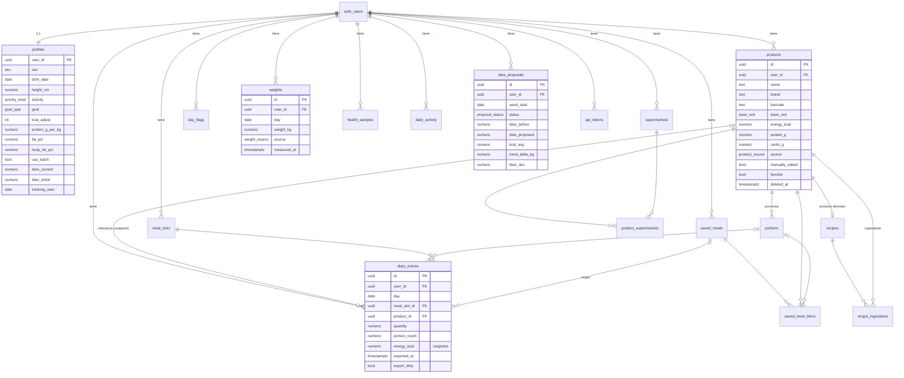

# 05 · Backend Schema

> Estado: **APROBADO (2026-11-16)** — decisiones abiertas cerradas con la propuesta · Fecha: 2026-11-16 · Depende de: PRD v1.1, TRD v1.1, App Flow y Design Brief (aprobados)
> Motor: Postgres 15 en Supabase. Extensiones: `pgcrypto`, `pg_trgm` y `unaccent`.

## 1. Decisiones de esta ronda
| # | Decisión |
|---|---|
| 1 | Identificadores **UUID** (`gen_random_uuid()`), que el cliente también puede generar. |
| 2 | Nutrientes en **8 columnas `numeric` que admiten null** en `products` y en el snapshot de `diary_entries`. |
| 3 | **Todo lleva `user_id`.** El seed se copia a tu usuario al darte de alta y la caché de APIs es tuya. |
| 4 | **Borrado lógico** (`deleted_at`) en productos, recetas y comidas guardadas; borrado físico en los registros del diario, los pesos y las muestras. |
| 5 | La **tendencia de peso se calcula en el cliente** y no se guarda. Las propuestas de TDEE se guardan en `tdee_proposals`. |
| 6 | Caché sin caducidad automática: se refresca al volver a consultarla si han pasado más de 90 días y el producto no se ha editado a mano. |

## 2. Diagrama ER



## 3. Entidades

| Tabla | Propósito | Notas |
|---|---|---|
| `profiles` | Perfil, parámetros del objetivo y TDEE vigente | 1:1 con `auth.users`. `tdee_current` solo cambia al aceptar una propuesta. |
| `meal_slots` | Comidas configurables (Desayuno…) con orden y hora de inicio | Se crean 5 por defecto al darte de alta. `start_time` alimenta la regla de la comida por hora. |
| `products` | Alimentos, productos de marca, recetas (derivadas) y caché de APIs | Nutrientes por 100 en `base_unit`. Guarda el origen, la confianza y los warnings de la IA, y `remote_snapshot`. |
| `portions` | Porciones caseras de un producto | `amount` en la `base_unit` del producto. `is_estimated` viene del JSON de la IA. |
| `supermarkets` | Supermercados que gestionas tú | Nombre único por usuario, sin distinguir mayúsculas ni tildes. |
| `product_supermarkets` | Relación N:M con precio opcional | `price_eur` y `price_updated_at`. |
| `recipes` | Metadatos de una receta | `product_id` apunta al producto derivado (`source = 'receta'`). |
| `recipe_ingredients` | Ingredientes de la receta | Cantidad en la `base_unit` del ingrediente. |
| `saved_meals` | Comidas guardadas (plantillas) | Con `favorite`. |
| `saved_meal_items` | Ítems de una comida guardada | Por cantidad o por porción. |
| `diary_entries` | Registros del diario | **Snapshot** de los 8 nutrientes calculados y de los valores por 100 usados, más el estado de exportación a Salud. |
| `day_flags` | Marca de día incompleto | Solo se crea fila cuando el día es incompleto. |
| `weights` | **Peso del día**, uno por día | Origen `manual` o `health`. El manual manda (§6). |
| `health_samples` | Muestras crudas recibidas de Salud | Deduplicadas por `external_id`. Sirven para auditar y recalcular. |
| `daily_activity` | Pasos y kcal activas por día | Una fila por día, con el máximo entre fuentes. Solo es informativa. |
| `tdee_proposals` | Historial de las evaluaciones semanales | Estados `pending`, `accepted`, `rejected`, `expired` y `skipped` (con el motivo). |
| `api_tokens` | Token personal para el atajo de Salud | Solo guarda el `sha256`. Revocable. |
| `seed_products` | Catálogo de partida (unos 150 alimentos) | Global y de solo lectura. Se copia a `products` al darte de alta. |

## 4. DDL SQL

```sql
-- =========================================================
-- 0. Extensiones y utilidades
-- =========================================================
create extension if not exists pgcrypto;
create extension if not exists pg_trgm;
create extension if not exists unaccent;

-- unaccent no es IMMUTABLE; este envoltorio sí, y permite usarlo en índices
create or replace function public.f_norm(t text) returns text
language sql immutable parallel safe as
$$ select lower(regexp_replace(public.unaccent('public.unaccent', coalesce(t,'')), '\s+', ' ', 'g')) $$;

create or replace function public.tg_set_updated_at() returns trigger
language plpgsql as $$ begin new.updated_at = now(); return new; end $$;

-- =========================================================
-- 1. Tipos
-- =========================================================
create type sex             as enum ('male','female');
create type activity_level  as enum ('sedentary','light','moderate','active','very_active'); -- 1.2/1.375/1.55/1.725/1.9
create type goal_type       as enum ('lose','maintain','gain');
create type base_unit       as enum ('g','ml');
create type product_source  as enum ('etiqueta','web','estimado','openfoodfacts','usda','manual','receta','aesan','seed');
create type confidence_lvl  as enum ('alta','media','baja');
create type weight_source   as enum ('manual','health');
create type health_type     as enum ('weight','steps','active_kcal');
create type proposal_status as enum ('pending','accepted','rejected','expired','skipped');

-- =========================================================
-- 2. Perfil y configuración
-- =========================================================
create table public.profiles (
  user_id          uuid primary key references auth.users(id) on delete cascade,
  sex              sex            not null,
  birth_date       date           not null check (birth_date between '1920-01-01' and current_date - interval '14 years'),
  height_cm        numeric(5,1)   not null check (height_cm between 120 and 230),
  activity         activity_level not null default 'moderate',
  goal             goal_type      not null default 'lose',
  kcal_adjust      int            not null default -400,
  protein_g_per_kg numeric(3,2)   not null default 1.80 check (protein_g_per_kg between 1.4 and 2.0),
  fat_pct          numeric(3,2)   not null default 0.27 check (fat_pct between 0.25 and 0.30),
  body_fat_pct     numeric(4,1)            check (body_fat_pct between 3 and 60),
  use_katch        boolean        not null default false,
  tdee_initial     numeric(6,1)   not null check (tdee_initial > 0),
  tdee_current     numeric(6,1)   not null check (tdee_current > 0),
  tracking_start   date           not null default current_date,
  theme            text           not null default 'system' check (theme in ('system','light','dark')),
  last_backup_at   timestamptz,
  created_at       timestamptz    not null default now(),
  updated_at       timestamptz    not null default now(),
  constraint kcal_adjust_by_goal check (
       (goal = 'lose'     and kcal_adjust between -500 and -300)
    or (goal = 'maintain' and kcal_adjust = 0)
    or (goal = 'gain'     and kcal_adjust between 150 and 300)),
  constraint katch_needs_bf check (not use_katch or body_fat_pct is not null)
);

create table public.meal_slots (
  id          uuid primary key default gen_random_uuid(),
  user_id     uuid not null references auth.users(id) on delete cascade,
  name        text not null check (length(name) between 1 and 40),
  position    smallint not null,
  start_time  time,                         -- null = solo selección manual (Snacks)
  archived    boolean not null default false,
  created_at  timestamptz not null default now(),
  updated_at  timestamptz not null default now(),
  unique (user_id, position) deferrable initially deferred
);

-- =========================================================
-- 3. Productos y catálogo
-- =========================================================
create table public.products (
  id               uuid primary key default gen_random_uuid(),
  user_id          uuid not null references auth.users(id) on delete cascade,
  name             text not null check (length(name) between 1 and 200),
  brand            text,
  barcode          text check (barcode ~ '^[0-9]{6,14}$'),
  category         text,
  base_unit        base_unit not null default 'g',
  package_size     numeric(8,2) check (package_size > 0),
  density_g_ml     numeric(5,3) check (density_g_ml > 0),          -- C2, opcional
  -- nutrientes por 100 g o 100 ml (null = desconocido)
  energy_kcal      numeric(7,2) check (energy_kcal     between 0 and 900),
  protein_g        numeric(6,2) check (protein_g       between 0 and 100),
  carbs_g          numeric(6,2) check (carbs_g         between 0 and 100),
  sugars_g         numeric(6,2) check (sugars_g        between 0 and 100),
  fat_g            numeric(6,2) check (fat_g           between 0 and 100),
  saturated_fat_g  numeric(6,2) check (saturated_fat_g between 0 and 100),
  fiber_g          numeric(6,2) check (fiber_g         between 0 and 100),
  salt_g           numeric(6,2) check (salt_g          between 0 and 100),
  -- origen y calidad
  source           product_source not null default 'manual',
  source_id        text,                    -- código de OFF, fdcId de USDA, id del seed
  confidence       confidence_lvl,
  warnings         text[] not null default '{}',
  needs_review     boolean not null default false,
  manually_edited  boolean not null default false,
  remote_snapshot  jsonb,                   -- respuesta cruda de la API (comparación manual)
  remote_fetched_at timestamptz,
  suggested_stores text[] not null default '{}',  -- de OFF; solo es una sugerencia
  favorite         boolean not null default false,
  last_used_at     timestamptz,             -- Recientes
  last_quantity    numeric(8,2),            -- favorito con un toque
  last_portion_id  uuid,
  name_norm        text generated always as (public.f_norm(name || ' ' || coalesce(brand,''))) stored,
  created_at       timestamptz not null default now(),
  updated_at       timestamptz not null default now(),
  deleted_at       timestamptz,
  constraint sugar_le_carbs check (sugars_g is null or carbs_g is null or sugars_g <= carbs_g + 0.5),
  constraint sat_le_fat     check (saturated_fat_g is null or fat_g is null or saturated_fat_g <= fat_g + 0.5)
);

create unique index products_barcode_uq on public.products (user_id, barcode)
  where barcode is not null and deleted_at is null;
create unique index products_source_uq  on public.products (user_id, source, source_id)
  where source_id is not null and deleted_at is null;
create index products_name_trgm  on public.products using gin (name_norm gin_trgm_ops) where deleted_at is null;
create index products_fav_idx    on public.products (user_id) where favorite and deleted_at is null;
create index products_recent_idx on public.products (user_id, last_used_at desc) where deleted_at is null;
create index products_review_idx on public.products (user_id) where needs_review and deleted_at is null;

create table public.portions (
  id           uuid primary key default gen_random_uuid(),
  user_id      uuid not null references auth.users(id) on delete cascade,
  product_id   uuid not null references public.products(id) on delete cascade,
  name         text not null check (length(name) between 1 and 60),
  amount       numeric(8,2) not null check (amount > 0),   -- en la base_unit del producto
  is_estimated boolean not null default false,
  created_at   timestamptz not null default now(),
  unique (product_id, name)
);
alter table public.products
  add constraint products_last_portion_fk foreign key (last_portion_id) references public.portions(id) on delete set null;

create table public.supermarkets (
  id         uuid primary key default gen_random_uuid(),
  user_id    uuid not null references auth.users(id) on delete cascade,
  name       text not null check (length(name) between 1 and 60),
  created_at timestamptz not null default now()
);
create unique index supermarkets_name_uq on public.supermarkets (user_id, public.f_norm(name));

create table public.product_supermarkets (
  product_id       uuid not null references public.products(id) on delete cascade,
  supermarket_id   uuid not null references public.supermarkets(id) on delete cascade,
  user_id          uuid not null references auth.users(id) on delete cascade,
  price_eur        numeric(7,2) check (price_eur >= 0),
  price_updated_at timestamptz,
  primary key (product_id, supermarket_id)
);
create index product_supermarkets_sm_idx on public.product_supermarkets (supermarket_id);

create table public.seed_products (
  id               text primary key,        -- p. ej. 'seed:avena'
  name             text not null,
  category         text,
  base_unit        base_unit not null default 'g',
  energy_kcal numeric(7,2), protein_g numeric(6,2), carbs_g numeric(6,2), sugars_g numeric(6,2),
  fat_g numeric(6,2), saturated_fat_g numeric(6,2), fiber_g numeric(6,2), salt_g numeric(6,2),
  portions         jsonb not null default '[]',   -- [{name, amount}]
  origin           text not null                  -- 'usda:<fdcId>' (CC0)
);

-- =========================================================
-- 4. Recetas y comidas guardadas
-- =========================================================
create table public.recipes (
  id               uuid primary key default gen_random_uuid(),
  user_id          uuid not null references auth.users(id) on delete cascade,
  product_id       uuid not null unique references public.products(id) on delete cascade,
  servings         numeric(5,2) check (servings > 0),
  cooked_weight_g  numeric(8,2) check (cooked_weight_g > 0),
  notes            text,
  created_at       timestamptz not null default now(),
  updated_at       timestamptz not null default now(),
  deleted_at       timestamptz
);

create table public.recipe_ingredients (
  id          uuid primary key default gen_random_uuid(),
  user_id     uuid not null references auth.users(id) on delete cascade,
  recipe_id   uuid not null references public.recipes(id) on delete cascade,
  product_id  uuid not null references public.products(id),     -- borrado lógico: nunca desaparece
  quantity    numeric(8,2) not null check (quantity > 0),
  position    smallint not null default 0
);
create index recipe_ingredients_recipe_idx on public.recipe_ingredients (recipe_id);

create table public.saved_meals (
  id          uuid primary key default gen_random_uuid(),
  user_id     uuid not null references auth.users(id) on delete cascade,
  name        text not null check (length(name) between 1 and 80),
  favorite    boolean not null default false,
  last_used_at timestamptz,
  created_at  timestamptz not null default now(),
  updated_at  timestamptz not null default now(),
  deleted_at  timestamptz
);

create table public.saved_meal_items (
  id            uuid primary key default gen_random_uuid(),
  user_id       uuid not null references auth.users(id) on delete cascade,
  saved_meal_id uuid not null references public.saved_meals(id) on delete cascade,
  product_id    uuid not null references public.products(id),
  quantity      numeric(8,2) not null check (quantity > 0),     -- en base_unit
  portion_id    uuid references public.portions(id) on delete set null,
  portion_count numeric(6,2) check (portion_count > 0),
  position      smallint not null default 0
);

-- =========================================================
-- 5. Diario
-- =========================================================
create table public.diary_entries (
  id               uuid primary key default gen_random_uuid(),
  user_id          uuid not null references auth.users(id) on delete cascade,
  day              date not null,                          -- día local Europe/Madrid
  logged_at        timestamptz not null default now(),
  meal_slot_id     uuid not null references public.meal_slots(id),
  product_id       uuid references public.products(id) on delete set null,
  saved_meal_id    uuid references public.saved_meals(id) on delete set null,
  -- cantidad
  quantity         numeric(8,2) not null check (quantity > 0),     -- en base_unit
  unit             base_unit not null,
  portion_id       uuid references public.portions(id) on delete set null,
  portion_name     text,                                   -- copia: "2 cucharadas"
  portion_count    numeric(6,2) check (portion_count > 0),
  -- snapshot (M16)
  product_name     text not null,
  product_brand    text,
  per100           jsonb not null,                         -- los 8 valores por 100 usados
  energy_kcal      numeric(8,2), protein_g numeric(7,2), carbs_g numeric(7,2), sugars_g numeric(7,2),
  fat_g numeric(7,2), saturated_fat_g numeric(7,2), fiber_g numeric(7,2), salt_g numeric(7,2),
  snapshot_at      timestamptz not null default now(),
  -- exportación a Salud
  exported_at      timestamptz,
  export_dirty     boolean not null default false,
  created_at       timestamptz not null default now(),
  updated_at       timestamptz not null default now()
);
create index diary_user_day_idx     on public.diary_entries (user_id, day);
create index diary_product_idx      on public.diary_entries (product_id, day);
create index diary_export_idx       on public.diary_entries (user_id, logged_at) where exported_at is null;

create table public.day_flags (
  user_id     uuid not null references auth.users(id) on delete cascade,
  day         date not null,
  incomplete  boolean not null default true,
  primary key (user_id, day)
);

-- =========================================================
-- 6. Peso, Salud y actividad
-- =========================================================
create table public.weights (
  id           uuid primary key default gen_random_uuid(),
  user_id      uuid not null references auth.users(id) on delete cascade,
  day          date not null,
  weight_kg    numeric(5,2) not null check (weight_kg between 30 and 300),
  source       weight_source not null,
  measured_at  timestamptz not null,
  sample_id    uuid,                         -- health_samples.id si viene de Salud
  created_at   timestamptz not null default now(),
  updated_at   timestamptz not null default now(),
  unique (user_id, day)
);

create table public.health_samples (
  id           uuid primary key default gen_random_uuid(),
  user_id      uuid not null references auth.users(id) on delete cascade,
  type         health_type not null,
  value        numeric(10,2) not null check (value >= 0),
  unit         text not null,
  start_at     timestamptz not null,
  end_at       timestamptz,
  source_name  text,
  external_id  text not null,                -- sha256(type|start|end|value|source)
  received_at  timestamptz not null default now(),
  unique (user_id, external_id)
);
create index health_samples_type_idx on public.health_samples (user_id, type, start_at);
alter table public.weights
  add constraint weights_sample_fk foreign key (sample_id) references public.health_samples(id) on delete set null;

create table public.daily_activity (
  user_id      uuid not null references auth.users(id) on delete cascade,
  day          date not null,
  steps        int  check (steps >= 0),
  active_kcal  numeric(7,1) check (active_kcal >= 0),
  updated_at   timestamptz not null default now(),
  primary key (user_id, day)
);

-- =========================================================
-- 7. TDEE adaptativo
-- =========================================================
create table public.tdee_proposals (
  id               uuid primary key default gen_random_uuid(),
  user_id          uuid not null references auth.users(id) on delete cascade,
  week_start       date not null check (extract(isodow from week_start) = 1),  -- lunes
  status           proposal_status not null,
  skip_reason      text,                     -- para 'skipped': 'arranque', 'dias<5', 'sin pesaje'
  days_logged      smallint,
  kcal_avg         numeric(7,1),
  trend_start_kg   numeric(5,2),
  trend_end_kg     numeric(5,2),
  trend_delta_kg   numeric(5,2),
  tdee_obs         numeric(7,1),
  tdee_before      numeric(7,1) not null,
  tdee_proposed    numeric(7,1),
  clamped          boolean not null default false,
  target_kcal_proposed numeric(7,1),
  decided_at       timestamptz,
  created_at       timestamptz not null default now(),
  unique (user_id, week_start),
  constraint skipped_has_reason check (status <> 'skipped' or skip_reason is not null),
  constraint proposal_has_values check (status = 'skipped' or tdee_proposed is not null)
);
-- como mucho una propuesta pendiente a la vez
create unique index tdee_one_pending on public.tdee_proposals (user_id) where status = 'pending';

-- =========================================================
-- 8. Token del atajo
-- =========================================================
create table public.api_tokens (
  id            uuid primary key default gen_random_uuid(),
  user_id       uuid not null references auth.users(id) on delete cascade,
  token_hash    text not null unique,        -- hex de sha256
  label         text not null default 'Atajo Salud',
  scope         text not null default 'health-sync' check (scope = 'health-sync'),
  last_used_at  timestamptz,
  revoked_at    timestamptz,
  created_at    timestamptz not null default now()
);
create unique index api_tokens_one_active on public.api_tokens (user_id) where revoked_at is null;

-- =========================================================
-- 9. Triggers updated_at
-- =========================================================
do $$ declare t text; begin
  foreach t in array array['profiles','meal_slots','products','recipes','saved_meals','diary_entries','weights'] loop
    execute format('create trigger set_updated_at before update on public.%I
                    for each row execute function public.tg_set_updated_at()', t);
  end loop;
end $$;

-- marcar export_dirty al editar un registro ya exportado
create or replace function public.tg_diary_dirty() returns trigger language plpgsql as $$
begin
  if old.exported_at is not null and (
       new.quantity is distinct from old.quantity or new.energy_kcal is distinct from old.energy_kcal
    or new.protein_g is distinct from old.protein_g or new.carbs_g is distinct from old.carbs_g
    or new.fat_g is distinct from old.fat_g or new.day is distinct from old.day) then
    new.export_dirty := true;
  end if;
  return new;
end $$;
create trigger diary_dirty before update on public.diary_entries
  for each row execute function public.tg_diary_dirty();

-- =========================================================
-- 10. Alta de usuario: comidas por defecto y copia del seed
-- =========================================================
create or replace function public.bootstrap_user() returns trigger
language plpgsql security definer set search_path = public as $$
begin
  insert into meal_slots (user_id, name, position, start_time) values
    (new.id,'Desayuno',1,'00:00'),(new.id,'Comida',2,'11:00'),
    (new.id,'Merienda',3,'16:00'),(new.id,'Cena',4,'19:30'),(new.id,'Snacks',5,null);

  with ins as (
    insert into products (user_id,name,category,base_unit,energy_kcal,protein_g,carbs_g,sugars_g,
                          fat_g,saturated_fat_g,fiber_g,salt_g,source,source_id)
    select new.id,s.name,s.category,s.base_unit,s.energy_kcal,s.protein_g,s.carbs_g,s.sugars_g,
           s.fat_g,s.saturated_fat_g,s.fiber_g,s.salt_g,'seed',s.id
    from seed_products s
    returning id, source_id
  )
  insert into portions (user_id, product_id, name, amount)
  select new.id, ins.id, p->>'name', (p->>'amount')::numeric
  from ins join seed_products s on s.id = ins.source_id
  cross join lateral jsonb_array_elements(s.portions) p;
  return new;
end $$;
create trigger on_auth_user_created after insert on auth.users
  for each row execute function public.bootstrap_user();

-- =========================================================
-- 11. RLS
-- =========================================================
do $$ declare t text; begin
  foreach t in array array['profiles','meal_slots','products','portions','supermarkets','product_supermarkets',
                           'recipes','recipe_ingredients','saved_meals','saved_meal_items','diary_entries',
                           'day_flags','weights','health_samples','daily_activity','tdee_proposals','api_tokens'] loop
    execute format('alter table public.%I enable row level security', t);
    execute format('create policy own_rows on public.%I for all to authenticated
                    using (user_id = (select auth.uid())) with check (user_id = (select auth.uid()))', t);
  end loop;
end $$;

alter table public.seed_products enable row level security;
create policy seed_read on public.seed_products for select to authenticated using (true);

-- el cliente no lee los hashes de los tokens; solo los gestiona mediante RPC
revoke select on public.api_tokens from authenticated;
grant select (id, label, last_used_at, revoked_at, created_at) on public.api_tokens to authenticated;
```

### 4.1 Funciones RPC (con `security invoker`, salvo donde se indica)
| Función | Propósito |
|---|---|
| `search_products(q text, supermarket uuid default null, only_fav bool default false, lim int default 30)` | Busca por `name_norm % f_norm(q)` o `ilike`, con el código de barras como coincidencia exacta. Ordena por similitud, favorito y `last_used_at`. |
| `apply_product_correction(p_product uuid, p_from date default null, p_to date default null)` | Recalcula el snapshot de los `diary_entries` de ese producto en el rango indicado. Devuelve el número de filas y la variación de kcal. Lo dispara el trigger `export_dirty`. |
| `create_api_token() returns text` (*security definer*) | Revoca el token activo, genera 32 bytes, guarda el `sha256` y devuelve el token **una sola vez**. |
| `revoke_api_token()` | Pone `revoked_at = now()`. |
| `import_products(payload jsonb, decisions jsonb)` | Importación en **una transacción** (TRD §8.2). `decisions` asigna a cada producto del JSON una acción (`update`, `merge`, `new` o `skip`) y el producto existente al que se refiere. |
| `restore_backup(payload jsonb)` | Restauración por tabla con *upsert* por `id`, en una transacción. |

La Edge Function `health-sync` usa la *service role key* y valida el token con `sha256` contra `api_tokens` (con `revoked_at is null`) antes de tocar ningún dato de ese `user_id`.

## 5. Reglas de cálculo que dependen del esquema
- **Snapshot:** al crear o editar un `diary_entry`, el cliente rellena `per100` y los 8 valores con `quantity · per100 / 100` (TRD §7.4). Si `per100.x` es null, el valor es null.
- **Totales del día:** se suman en el cliente o con `select sum(...) ... where day = $1`. `count(*) filter (where fiber_g is null) > 0` indica un total parcial.
- **Días registrados (TDEE):** `select day from diary_entries ... group by day except select day from day_flags where incomplete`.

## 6. Peso del día y deduplicación (`health-sync`)
```text
para cada muestra recibida:
  external_id = sha256(type|start|end|value|source)
  insert into health_samples ... on conflict (user_id, external_id) do nothing
  si es nueva y type = 'weight' y 30 ≤ value ≤ 300:
     day = (start_at at time zone 'Europe/Madrid')::date
     upsert weights (user_id, day):
       - si no existe            → insertar source='health'
       - si existe source='manual' → no tocar
       - si existe source='health' y measured_at nuevo < actual → reemplazar (la más temprana)
  si type in ('steps','active_kcal'):
     daily_activity(day).x = greatest(actual, agregado_por_fuente(day, x))
     -- agregado_por_fuente = suma de las muestras de esa fuente en el día; se queda el máximo entre fuentes
respuesta.to_export = diary_entries where exported_at is null order by logged_at limit 200
ack_exported → update diary_entries set exported_at = now(), export_dirty = false where id = any(...)
```
Si introduces un peso a mano, se hace un *upsert* con `source = 'manual'`, que siempre sobrescribe lo que haya ese día.

## 7. Estrategia de caché de alimentos externos
| Paso | Regla |
|---|---|
| Búsqueda de un código de barras | 1) `products where barcode = $1 and deleted_at is null`. Si existe, se devuelve **sin llamar a OFF**. 2) Si no, `food-lookup` llama a OFF. |
| Búsqueda de texto | 1) `search_products` en local. 2) Solo si lo pides con "Buscar en USDA / OFF" se llama a la API. Los resultados se muestran sin guardar; **solo se guarda el que eliges** (para no llenar la base). |
| Guardado | `insert ... on conflict (user_id, source, source_id)`, con `remote_snapshot` y `remote_fetched_at = now()`. |
| Refresco | Al volver a consultar un producto con `manually_edited = false` y `remote_fetched_at < now() − 90 días`, se actualizan los nutrientes, el nombre y la marca. Si `manually_edited = true`, solo se actualiza `remote_snapshot`. |
| Coherencia | En la Edge Function: si `|kcal − (4P + 4C + 9G)| / kcal > 0.20`, entonces `needs_review = true`. |
| Errores de la API | Un timeout de 5 s y un reintento. Si falla, no se guarda nada y se muestra un error. Un `status = 0` de OFF significa "no encontrado", no un error. |
| Límite de USDA | `food-lookup` lleva un contador en memoria y, por si acaso, responde 429 a partir de 900 peticiones por hora. |
| Tamaño | Unos 150 productos del seed y unos 2.000 en caché a 2 KB cada uno, unos 4 MB. El plan gratuito de Supabase da 500 MB. |

## 8. Formato de intercambio: forma de cada clave (TRD §8.1)
El bloque `products` sigue el formato de la IA tal cual. Para la copia de seguridad añade los campos opcionales `id`, `favorite`, `manually_edited`, `needs_review`, `source_id`, `created_at`, `updated_at` y `supermarket_prices: [{name, price}]`. Correspondencia con las columnas:

| JSON | Columna |
|---|---|
| `nutrients_per_100.energy_kcal` … `salt_g` | `energy_kcal` … `salt_g` |
| `portions[].{name, amount, estimated}` | `portions.{name, amount, is_estimated}` |
| `supermarkets[]` (nombres) | `supermarkets` + `product_supermarkets` |
| `source`, `confidence`, `warnings` | Igual |

Claves de la copia de seguridad (todas opcionales y con `id` UUID):
```jsonc
"profile":      { /* columnas de profiles sin user_id */ },
"meal_slots":   [{ "id", "name", "position", "start_time", "archived" }],
"supermarkets": [{ "id", "name" }],
"recipes":      [{ "id", "product_id", "servings", "cooked_weight_g", "notes",
                   "ingredients": [{ "product_id", "quantity", "position" }] }],
"saved_meals":  [{ "id", "name", "favorite",
                   "items": [{ "product_id", "quantity", "portion_name", "portion_count", "position" }] }],
"diary":        [{ "id", "day", "logged_at", "meal_slot_id", "product_id", "quantity", "unit",
                   "portion_name", "portion_count", "product_name", "product_brand", "per100", "nutrients": {…8},
                   "exported_at" }],
"day_flags":    [{ "day", "incomplete" }],
"weights":      [{ "id", "day", "weight_kg", "source", "measured_at" }],
"daily_activity": [{ "day", "steps", "active_kcal" }],
"tdee_history": [{ /* columnas de tdee_proposals sin user_id */ }]
```
`health_samples` y `api_tokens` **no se exportan**: las muestras son crudas y se pueden volver a obtener de Salud, y los tokens son secretos.

## 9. Migraciones
- `supabase/migrations/0001_init.sql`: §4 completo.
- `0002_rpc.sql`: las funciones de §4.1.
- `0003_seed_products.sql`: los inserts del seed, generados por `scripts/build-seed.ts`.
- Tipos de TypeScript generados con `supabase gen types typescript`.

## Decisiones abiertas
1. **Tope de `to_export` por ejecución** del atajo. Propuesta: 200 registros; si hay más, se exportan en las siguientes ejecuciones.
2. **Límites de las comprobaciones de nutrientes** (`energy_kcal ≤ 900`, el resto ≤ 100). Propuesta: mantenerlos. Los aceites puros tienen unas 900 kcal por 100 ml, así que encajan.
3. **Índice trigram sobre `name || brand`.** Propuesta: sí, para poder buscar por marca ("hacendado yogur").

## Supuestos
- Un día se asigna en la zona horaria Europe/Madrid. Lo calcula el cliente (`day`) y la Edge Function para Salud.
- La extensión `unaccent` está disponible en Supabase (es así a fecha de 2026).
- Con un solo usuario no hace falta particionar ni archivar: un año son unos 2.500 registros del diario, 365 pesos y unas 5.000 muestras.
- `auth.users` admite triggers de alta en Supabase, que es el patrón documentado.
